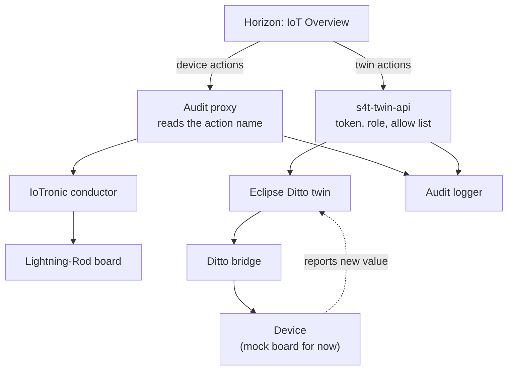

---
output:
  word_document: default
  html_document: default
---

# Acting on Devices and Twins from the IoT Overview

Author: Mohsen Ghalem
Date: 1 November 2026
Project: Stack4Things, Industry 5.0 extension work, Phase 1

---

## 1. What it is

The IoT Overview page in Horizon is now also where operators act on a machine. It began as a separate Device Control panel next to Overview; the two showed the same machines, so they were merged into one page, where the selected machine's state, its controls and its activity sit side by side. The Overview's system view (totals, data path health) is kept.

It offers six actions, the Phase 1 action catalogue:

| Action | What it does | Path | Who may use it | Confirmation | Audit record |
|---|---|---|---|---|---|
| Ping | Checks the agent on the device answers | Conductor, `DevicePing` | any logged in user | no | `device.ping` |
| Echo | Sends a message to the device and back | Conductor, `DeviceEcho` | any logged in user | no | `device.echo` |
| Restart LR | Restarts the Lightning-Rod agent | Conductor, `DeviceRestartLR` | admin | yes | `device.restart_lr` |
| Reboot | Reboots the device | Conductor, `DeviceReboot` | admin | yes | `device.reboot` |
| Set desired | Asks the device to change a setting, through its twin | `s4t-twin-api`, then Ditto | admin | yes | `desired.set` |
| Clear desired | Withdraws a pending request | `s4t-twin-api`, then Ditto | admin | no | `desired.clear` |

Every action is recorded in the audit log under the operator's own Keystone name, with its own verb.

### The page

The layout follows industrial HMI practice (ISA-101) rather than a list of buttons per row.

- **Select, then act.** The machine list is on the left, with a filter and four views: all, online, not online, and machines with a pending request. Each machine shows how long ago its twin last changed, flagged when stale. Under the list, *Data paths* shows when each part of the system last delivered something. Everything about the selected machine is on the right: its status, twin revision, last report, last action and who took it, and its twin attributes. The arrow keys move through the list. The selection is kept in the address (`?board=<uuid>`), so a reload opens on the same machine.
- **Neutral by default.** Colour appears only for a state that needs attention, and never on its own: every state also has a word and a shape (filled dot online, ring offline, dashed square registered).
- **Risk decides placement.** The right-hand side has three sections in this order:
  1. **Desired state**, the routine operation. Each property the allow list permits has its control on its own row, next to its reported value, its requested value and whether the machine has reached it. Changes are collected first and sent together after a review step.
  2. **Device commands**, in two groups: *Diagnostics* (Ping, Echo), one click; *Maintenance* (Restart agent, Reboot device), visually separated, and confirmed by typing the machine's name.
  3. **Your commands**: the outcome and timing of what the operator ran in this session, next to the controls that ran it. It appears once there is something to show.
- **Twin attributes** open as a key/value table. A nested object, such as `provisioning`, opens as a table of its own inside its row, long values wrap, and the table scrolls inside its box, so nothing runs off the screen.
- **Activity log, a page of its own.** The *Activity log* button in the machine's header opens `board/<uuid>/log/`: the machine's whole audit history, searched and filtered on the server. A real device reports every few seconds, so after a day the interesting record is rarely among the last rows.
  - Free-text search matches the action, the person, the values inside a record (a property name, `DeviceReboot`) and correlation ids. `/` jumps to it.
  - Filters: category (device commands, desired state, plugins and services, board changes, telemetry, system), who, operator, result (failures only) and period (last hour to last 30 days). **Telemetry is hidden by default.**
  - The filters are kept in the page address, so a filtered view can be bookmarked or sent to a colleague.
  - Clicking a row opens its full detail. *Related records* finds every record sharing its correlation id, for example an operator's desired-state write next to the change Ditto recorded for it.
  - 100 records at a time with *Load 100 older*. Live updates run on the first page only, so rows never move while someone reads older ones.
  - *Export shown (CSV)* downloads exactly the rows on screen, with cells that a spreadsheet could read as formulas made safe.
- **Unavailable means explained.** A disabled command says why next to it ("Machine not online", "Requires role: admin"). An offline machine shows a banner saying commands are unavailable and that desired values will wait for it.
- **Stale data is visible.** The status strip shows when the list last refreshed and turns red if it stops refreshing.

## 2. How it works

There are two paths, and they meet in the audit log.



**Figure 1. Device actions through IoTronic, twin actions through Ditto.**

**Device actions** go from the Horizon server to the conductor with the operator's own Keystone token. The panel finds the conductor through the Keystone catalog, exactly as Horizon does, so the request passes through the audit proxy without any extra code. Before sending, the panel reads the board from the conductor and refuses if it is not `online`.

**Twin actions** go from the Horizon server to a new service, `s4t-twin-api`, again with the operator's token. That service:

1. asks Keystone to validate the token, and takes the user name and roles from Keystone's answer, never from a header;
2. checks the role (`TWIN_WRITE_ROLES`, default `admin`);
3. checks every value against the allow list (`conf_twin/twin_allowlist.json`), and refuses the whole request if one value is wrong;
4. writes the desired value to Ditto as a merge addressed at `features/telemetry/desiredProperties`, with a `correlation-id`. The address matters: the bridge only forwards changes whose path contains `desiredProperties`, so a merge at the twin's root would never reach the device. A twin whose device has never reported has no `telemetry` feature yet; the service refuses with 409 rather than create one for a device that is not listening;
5. sends an audit record with the operator's name and the same correlation id.

The bridge then sends the difference to the device, the device applies it and reports the new value, and the twin shows the property as converged. That part already existed and is unchanged.

**The browser only ever talks to Horizon.** Every call to the conductor and to the twin service is made server side, from inside the Horizon container. The Ditto password stays in `s4t-twin-api`. The twin service publishes no port.

## 3. The audit fix that comes with it

IoTronic sends many operations to one URL and names the operation in the request body. Before this change, the audit proxy classified on the URL alone, so a reboot and a ping were both `board.action`, and enabling and disabling a service were both `service.expose`.

The proxy now reads the `action` field of the body and derives the verb from it: it removes the family prefix and converts the rest to `snake_case`. `DeviceReboot` becomes `device.reboot`, `ServiceDisable` becomes `service.disable`, `PluginStart` becomes `plugin.start`. The raw name is kept in `action.detail.action`. A name that would not make a clean verb falls back to the old verb. Two route fixes came with it: restoring services (a `GET` that changes the device) is now recorded as `service.restore`, and `PUT /v1/boards/<id>/plugins`, IoTronic's real injection route, is `plugin.inject`.

The full vocabulary is in `docs/Audit_API_Reference.md`. Records already in the log keep their old verbs.

## 4. Desired state on the twin

The twin dialog shows, for each desired property, the desired value, the reported value, and a state:

| State | Meaning |
|---|---|
| converged | the device reports the desired value |
| pending | not yet, set less than `TWIN_CONFIRM_TIMEOUT` seconds ago (default 60) |
| not confirmed | not yet, and set longer ago than that. The device may be offline or may not understand the property |

The time a value was set is kept in memory by `s4t-twin-api`. After a restart a value that is still waiting shows as pending with no age, rather than an invented one.

**The allow list.** Only properties listed in `conf_twin/twin_allowlist.json` can be set. It ships with one, `fan_on`, which the mock board understands. The file is read on every request, so an edit takes effect without a restart. A missing or broken file refuses every write. In Phase 3 this file is replaced by the twin definition from the D8.1 SDF model.

**Real boards.** Today only `s4t_mock_board.py` listens for desired values. Real Lightning-Rod boards will need the twin-agent plugin planned for Phase 7. Device actions work on real and simulated Lightning-Rod boards now.

## 5. Files

| File | What it is |
|---|---|
| `panels/iot_overview/` | The Overview panel: `views.py`, `urls.py`, `index.html` (the Overview) and `activity.html` (a machine's activity log). Routes: the page, the machine list, the activity log page and its search, device actions, and the three twin relays |
| `panels/iot_overview/sidebar_order.py` | Moves Overview to the top of the IoT sidebar (Horizon appends added panels to the end) |
| `panels/_6005_iot_overview_panel.py` | Registers the panel in the `default` group and switches `sidebar_order` on |
| `scripts/s4t_dashboard.py` | Changed: `GET /board/<uuid>/events`, the filtered, paged activity search |
| `scripts/test_activity_search.py` | Tests the search against a real SQLite store with the audit schema |
| `scripts/s4t_twin_api.py` | The twin command service |
| `conf_twin/twin_allowlist.json` | Properties an operator may set |
| `scripts/s4t_audit_proxy.py` | Changed: verbs from the request body |
| `scripts/s4t_audit_logger.py` | Changed: keeps Ditto's correlation id on twin records |
| `scripts/test_twin_api.py` | Tests for every decision the twin service takes |
| `scripts/test_audit_vocabulary.py` | Changed: covers the new verbs and the real routes |
| `scripts/verify_actions.sh` | Acceptance tests T1 to T7 against the running stack |
| `docker-compose.ditto.yml` | The `s4t-twin-api` service and two new mounts on `iotronic-ui` |
| `docker/ditto-tools/Dockerfile` | One line that copies the twin service into the image |

## 6. Configuration

On `s4t-twin-api`, all optional, in `.env`:

| Setting | Default | Meaning |
|---|---|---|
| `TWIN_WRITE_ROLES` | `admin` | Roles that may set or clear desired state |
| `TWIN_READ_ROLES` | empty | Roles that may read twin status. Empty means any valid token |
| `TWIN_CONFIRM_TIMEOUT` | `60` | Seconds before a waiting value shows as not confirmed |
| `TWIN_FAIL_CLOSED` | `0` | `1` refuses writes while the audit queue is unreachable |

On the panel:

| Setting | Default | Meaning |
|---|---|---|
| `S4T_DEVICE_ADMIN_ROLES` | `admin` | Roles that may reboot or restart the agent from the panel |
| `S4T_ACTION_TIMEOUT` | `30` | Seconds to wait for the device to answer |

The panel's code defaults to these same values. That matters because Apache can start Horizon with an empty environment, in which case the compose variables never reach it.

The conductor applies its own policy on top of the panel's checks. The panel can only narrow what an operator may do, never widen it.

## 7. Installing it

```bash
dcs() { docker compose -f docker-compose.yml -f docker-compose.ditto.yml "$@"; }
dcs build s4t-twin-api
dcs up -d --no-deps s4t-twin-api iotronic-ui
dcs up -d --no-deps --force-recreate s4t-audit-proxy s4t-audit-logger
```

All the twin layer services share one image, so the build refreshes it for all of them. `--no-deps` recreates only the services named, rather than everything built from that image. The proxy and the logger are recreated because their code changed; the proxy sits in Horizon's IoT path, so expect a few seconds where IoT pages fail. Horizon is recreated because its mounts changed, which restarts it. No volume is touched.

The activity search runs in the dashboard aggregator, which lives inside `s4t-audit-logger`; that is a second reason the logger is rebuilt and recreated. The sidebar order is read when Horizon starts, so it needs the `iotronic-ui` restart too.

If Horizon is configured to use the `internalURL` endpoint type, device actions bypass the audit proxy. T7 in the verification script shows that: `device.ping` would be missing from the log.

## 8. Checking it

```bash
./scripts/verify_actions.sh
LR_BOARD=<online lr-sim board> TWIN_BOARD=<mock board uuid> ./scripts/verify_actions.sh
```

| Test | What it proves |
|---|---|
| T1 | Ping reaches Lightning-Rod through the conductor |
| T2 | Reboot works and the board comes back. Runs only with `RUN_REBOOT=1` |
| T3 | A user without the admin role is refused. Needs `MEMBER_USER` and `MEMBER_PASS` |
| T4 | A desired value reaches the mock board and converges, then is cleared |
| T5 | A value outside the allow list never reaches the twin |
| T6 | The twin service refuses a missing or forged token |
| T7 | Every action above is in the audit log, with a name and its own verb |

T4 and T5 change only the board named in `TWIN_BOARD`. Name the mock board, never a real machine. T8, removal, is done by hand (section 10).

## 9. Two things to confirm on the first run

These could not be checked without the running stack, and T1 answers both.

1. **The request body.** The panel sends `{"action": "DevicePing", "parameters": {}}` to `POST /v1/boards/<id>/action`, as described in the SDF mapping. If the deployed conductor expects a different shape, T1 fails with its error message, and the fix is one line in `ACTIONS` in `panels/iot_overview/views.py`.
2. **The conductor's policy.** The default IoTronic policy allows board actions to admins only. If so, Ping and Echo are refused for non-admin users by the conductor even though the panel offers them. The panel shows the conductor's refusal as it is.

## 10. Removing it

| To remove | Do this |
|---|---|
| Twin actions | Remove the `s4t-twin-api` service. Overview keeps working; its twin actions report the service as unreachable |
| Device actions | Remove the `device_action` route in `panels/iot_overview/urls.py` |

Nothing else depends on either. The audit proxy change stands on its own and is kept.

## 11. Limits

- Twin actions work only with devices that listen for desired values: the mock board today, real boards after the Phase 7 plugin.
- The panel polls every few seconds. It is current to within a few seconds, not to the instant.
- `NetConfig`, `UpgradeLR` and `PkgOperation` are deliberately not offered. The audit proxy already records them correctly if they are used by another route.
- The SDF mapping in `docs/D8.1_sdf/` still names `board.action` as the audit verb for device actions. It should now name the specific verbs (`device.reboot` and so on).
- **No per-project scoping.** The twin service checks roles, not which project a board belongs to. Any valid token may read any twin's status, as the Overview panel already shows to every user, and every user with a write role may write every twin. That is right for one lab. If several tenants share the platform, the twin service needs to check the board's project against the token's.
- **Audit verbs changed.** Anything downstream that filters on `board.action`, `service.expose` or `plugin.execute` needs updating: those requests now carry specific verbs. The ledger developer should be told.
